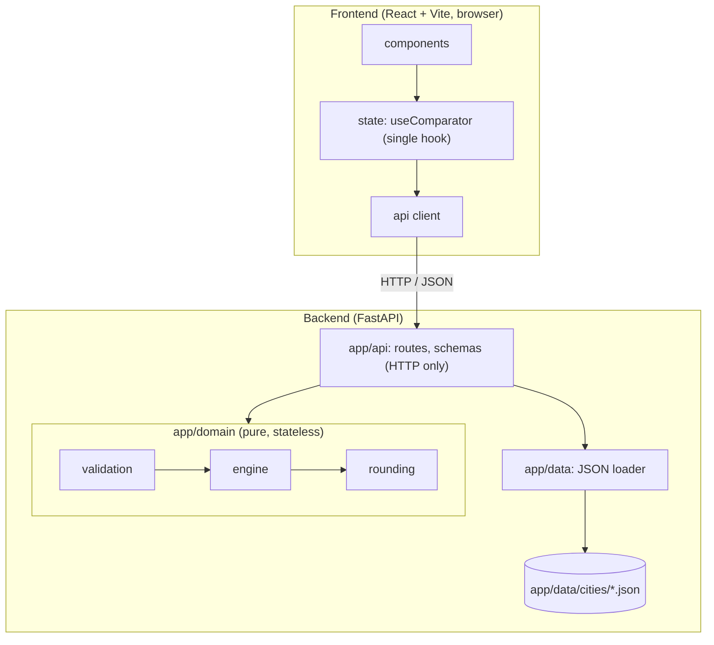

# Architecture

> **Purpose:** Show how the system is layered and how data flows.
> **Owner of:** layers and allowed dependencies, folder structure, data flows, frontend sync and stale-response design.
> **Read this when:** adding a file, a module, an import across layers, or wiring frontend state.

## System diagram

The engine is stateless: input in, result out, no I/O, no globals. **Only the backend calculates.** The frontend renders API output and formats integer rupees.

## Layers and allowed dependencies
Arrows point downward only. A layer never imports from a layer above it.

| Layer | Path | Responsibility | May import |
|---|---|---|---|
| UI components | `Frontend/src/components/` | Render props; emit user events | `types`, `utils`; hook via `App` props/context |
| State | `Frontend/src/state/` | One hook: inputs, inspected hotel, result, request sequencing | `api`, `types` |
| API client | `Frontend/src/api/` | `fetch` wrappers, JSON parse only | `types` |
| Contracts | `Frontend/src/types/` | Types mirroring [API_SPECIFICATION.md](API_SPECIFICATION.md) | nothing |
| Routes | `Backend/app/api/` | Parse request, load city, build scenario, call domain, return | `data`, `domain` |
| Data | `Backend/app/data/` | Read JSON files | stdlib |
| Domain | `Backend/app/domain/` | Validate, compute, rank, round | stdlib only (no FastAPI, no pydantic, no I/O) |

Domain internals: `validation.py` and `engine.py` use `rounding.py` and `models.py`; `rounding.py` imports nothing local.
`Backend/scripts/` and `verification/` are never imported by `Backend/app/`.

## Folder structure
```
Backend/
  app/
    main.py            FastAPI app, CORS for the Vite dev server
    api/               routes.py, schemas.py (loose request shapes)
    domain/            models.py, validation.py, engine.py, rounding.py
    data/              JSON loading; cities/<city_id>.json
  scripts/             design_helper.py: one-time deterministic matrix generator
  tests/               unit/ scenario/ api/ fixtures/
  pyproject.toml       dependencies, ruff, pytest config (planned, T04)
Frontend/
  src/
    api/               client.ts (planned, T09)
    types/             contracts.ts mirrors the API spec (planned, T09)
    state/             useComparator.ts (planned, T09)
    utils/             currency.ts: en-IN formatting only (planned, T09)
    components/        CityMap/ Controls/ ExplanationPanel/ HotelRanking/ StatusBanner/ TravelMatrixTable/ (planned, T10–T13); Selection/ (planned, T16)
    __tests__/         Vitest + React Testing Library
verification/          Independent expected results; read by tests only
docs/                  The 13 spec docs; source/ originals; interview/ deliverables
```

## Data flows
| Scenario | Steps |
|---|---|
| **Load Demo trip** | UI → hook `load()` → `GET /presets/demo` → hook stores selection, budget, importances → `GET /api/cities/{id}` (once, for names/positions/matrix) → `POST /api/compare` with the preset → result stored → inspected hotel = `default_inspected_hotel_id` |
| **Change budget** | UI input → hook sets budget → `POST /api/compare` (same selection and importances) → new result; affordability, shortfalls, ranks, recommendation change; contributions identical |
| **Change one importance** | UI input → hook sets that place's importance → `POST /api/compare` → all contributions, totals, averages, ranks change |
| **Invalid input** | UI sends the raw value (not pre-validated) → route passes it through → `validation.py` returns errors → API returns `INVALID`, 200, derived fields empty → hook stores the result → banner shows `errors[]`; ranking, map links, explanation clear; inputs stay editable |

Inspecting a hotel is local state only (no request): it changes the explanation panel, table highlight and map links, never the result.

## Request sequencing (frontend)
- Each `compare` call takes `++requestSeq`; the response is applied only if its number equals the latest. Older responses are dropped.
- Loading state is tied to the latest request only.
- After a result arrives, the inspected hotel is kept if it is still in `hotels`; otherwise it falls back to `default_inspected_hotel_id`. On `INVALID`, the inspection has nothing to show.

## Keeping the views in sync
One hook, `useComparator`, owns all state: `selection`, `budget`, `importances`, `inspectedHotelId`, `result`, `loading`. `App` passes slices down as props. Map, ranking, table, explanation panel and banner all render the **same `result` object** and the same `inspectedHotelId`; none keeps a copy, none derives a number. Static catalog data (names, positions) comes from `GET /api/cities/{id}`, held beside the result.
