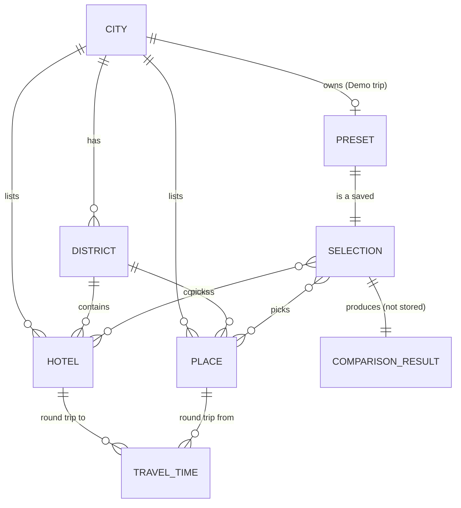

# Database Design (JSON data design)

> **Purpose:** Define the JSON files that hold city data. **There is no database.**
> **Owner of:** city JSON schema, ID/type/range rules, matrix generation method, Demo preset structure, rules for adding a city.
> **Read this when:** touching `Backend/app/data/`, `Backend/scripts/`, the generator, the Demo trip data, or writing data-structure tests.

API shapes built from this data: [API_SPECIFICATION.md](API_SPECIFICATION.md).

## Storage
| Item | Decision |
|---|---|
| Storage | One JSON file per city: `Backend/app/data/cities/<city_id>.json` (planned, T03) |
| Source of truth | The frozen JSON. A generator may produce it once; the JSON is what the app reads |
| Reads | `Backend/app/data/` loads files, nothing else. No validation of business rules, no calculation |
| Writes | Never at runtime. Files change only by a deliberate task and a commit |
| Phase A (T03) | Final schema, short arrays: the 10 Demo hotels, 15 Demo places, 10×15 matrix |
| Phase B (T15) | Grow to 30 hotels / 50 places / 30×50 matrix per city; add a second city |

## City file schema
| Field | Type | Rules |
|---|---|---|
| `city_id` | string | Same as file name; lowercase `[a-z0-9_]+` |
| `name` | string | Non-blank |
| `map` | `{width:int, height:int}` | SVG viewBox; presentation only |
| `districts` | `[{id, name}]` | District IDs unique; used by the generator and the map |
| `hotels` | `[Hotel]` | Phase B: exactly 30 |
| `places` | `[Place]` | Phase B: exactly 50 |
| `round_trip_minutes` | `{hotel_id: {place_id: int}}` | Complete: every hotel × every place; whole minutes 1–600 |
| `demo_preset` | `DemoPreset \| null` | Present in exactly one city (the primary one) |

**Hotel:** `id`, `name`, `stay_cost` (int 1–1,000,000, whole ₹ for the complete stay), `district_id`, `position {x,y}`.
**Place:** `id`, `name`, `type` (`attraction` \| `food`), `default_importance` (int 1–5), `district_id`, `position {x,y}`.
**DemoPreset:** `hotel_ids` (10), `place_ids` (15), `importances {place_id: int}`, `budget` (int 0–1,000,000).

Positions are **presentation data only**: never used to compute minutes, totals or ranks.

### Small example (illustrative, 2×3)
```json
{
  "city_id": "example_city", "name": "Example City",
  "map": { "width": 1000, "height": 700 },
  "districts": [ { "id": "OLD", "name": "Old Town" }, { "id": "RIV", "name": "Riverside" } ],
  "hotels": [
    { "id": "H_RIVER", "name": "Riverside Inn", "stay_cost": 4200, "district_id": "RIV", "position": { "x": 210, "y": 340 } },
    { "id": "H_FORT", "name": "Fort View Hotel", "stay_cost": 5200, "district_id": "OLD", "position": { "x": 520, "y": 260 } }
  ],
  "places": [
    { "id": "CLOCK", "name": "Clock Tower", "type": "attraction", "default_importance": 3, "district_id": "OLD", "position": { "x": 480, "y": 120 } },
    { "id": "MARKET", "name": "Night Market", "type": "attraction", "default_importance": 2, "district_id": "OLD", "position": { "x": 600, "y": 300 } },
    { "id": "DOSA", "name": "Dosa House", "type": "food", "default_importance": 5, "district_id": "RIV", "position": { "x": 260, "y": 420 } }
  ],
  "round_trip_minutes": {
    "H_RIVER": { "CLOCK": 20, "MARKET": 40, "DOSA": 30 },
    "H_FORT":  { "CLOCK": 10, "MARKET": 25, "DOSA": 20 }
  },
  "demo_preset": null
}
```

## ID and value rules
| Rule | Detail |
|---|---|
| ID format | `[A-Z][A-Z0-9_-]{0,15}`, checked with `re.fullmatch` |
| Uniqueness | Unique across **hotels and places together** within a city |
| Type enum | `attraction` \| `food` |
| Ranges | budget 0–1,000,000 · stay_cost 1–1,000,000 · importance 1–5 · minutes 1–600 · all whole numbers |
| Demo trip | ≥3 attractions, ≥3 food, ≥3 distinct importance values |
| Mapping | Keys of each hotel's row equal the place IDs exactly: no missing, no extra |

## Matrix generation (Phase B; Phase A uses hand-authored constants)
```
minutes(h, p) = base[district(h)][district(p)] + hotel_offset[h] + place_offset[p]
```
| Rule | Detail |
|---|---|
| Inputs | District base table (minutes), per-hotel integer offset, per-place integer offset. All integers |
| Forbidden | Randomness, map coordinates, distance, floats |
| Range | The generator **asserts** every result is 1–600 (it never clamps silently) |
| Demo block | The 10×15 Demo-trip cells are hand-authored overrides applied after generation (and are the only cells in Phase A) |
| Freeze | Output is written to the city JSON and committed. Re-running the generator must give byte-identical output (test, T15) |
| Hand-tuned cells | Any cell changed by hand to satisfy a story condition is logged in [DECISIONS.md](DECISIONS.md) |
| Location | `Backend/scripts/design_helper.py` (run by hand; never imported by `Backend/app/`) |

## Demo preset constraints
At its initial budget the preset must satisfy S1–S6 from [PROJECT_OVERVIEW.md](PROJECT_OVERVIEW.md). Expected results are recorded independently in `verification/` (planned, T03) and compared only by tests.

## Entity relationships

| Entity | Stored? | Notes |
|---|---|---|
| City, District, Hotel, Place, TravelTime | Yes (city JSON) | TravelTime = one `round_trip_minutes` cell |
| Preset | Yes (`demo_preset`) | A Selection plus budget and importances |
| Selection | No (request body) | `hotel_ids`, `place_ids`, `importances`, `budget` |
| ComparisonResult | No | Computed per request; stateless |

## Adding a new city
1. Choose `city_id`; create `Backend/app/data/cities/<city_id>.json` following this schema (30 hotels, 50 places, full matrix).
2. Define districts and base table; add the city's generator parameters to `Backend/scripts/design_helper.py`; run it once; commit the JSON.
3. Set `demo_preset` to `null` (only the primary city owns the Demo trip).
4. Add tests: counts, ID format and uniqueness, matrix completeness and ranges, regeneration is identical.
5. Update this doc and `Backend/app/data/README.md` if the schema changes. No code change should be needed to list the city.
